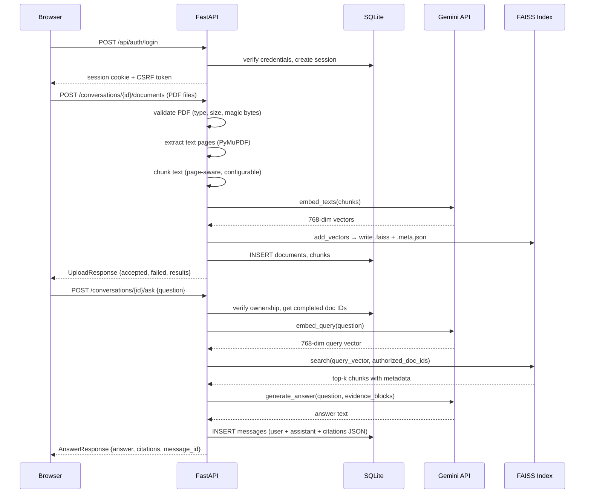

# DocuMind

**AI-powered document intelligence — chat with your PDFs, get grounded answers with exact source citations.**

---

## Table of Contents

1. [Overview](#overview)
2. [Features](#features)
3. [Technology Stack](#technology-stack)
4. [Architecture](#architecture)
5. [Project Structure](#project-structure)
6. [Quick Start](#quick-start)
7. [Environment Configuration](#environment-configuration)
8. [Running Tests](#running-tests)
9. [Security Summary](#security-summary)
10. [Known Limitations](#known-limitations)
11. [Deployment](#deployment)

---

## Overview

### Problem

Knowledge workers spend significant time searching through long PDF documents — research papers, policy documents, reports, legal contracts — to find specific answers. Manual search is slow, error-prone, and does not surface the exact page or passage where the answer lives.

### Solution

DocuMind lets users upload multiple PDFs, ask natural-language questions, and receive answers that are:

- **Grounded in retrieved evidence** — the AI reads only what was extracted from the uploaded documents.
- **Cited** — every answer includes the source filename and the actual page number from the PDF.
- **Private** — each user's documents and conversations are strictly isolated; no other user (including administrators) can access them.

### Intended Users

- Researchers and analysts who work with large document collections.
- Teams that need to query internal reports or policy documents quickly.
- Students reviewing study material in PDF form.

> **Data privacy notice:** DocuMind uses the Google Gemini API to embed and generate answers. Document text is sent to Google's servers during processing. Do not upload confidential documents until your organization has reviewed Google's applicable data-handling terms.

---

## Features

All features listed below are implemented and verified in the codebase.

### Authentication and Access Control
- Username/email and password login with PBKDF2-SHA256 hashing (600 000 iterations)
- Server-managed session cookies (HttpOnly, SameSite)
- CSRF double-submit protection on all state-changing requests
- In-memory rate limiting: 5 failed attempts per 5 minutes per IP/identifier
- Role-based access: `user` and `admin`
- Administrator-controlled account approvals — new accounts start as `pending`
- Account states: `pending`, `approved`, `rejected`, `deactivated`
- Immediate session revocation on deactivation

### User Workspace
- Create, rename, and delete conversations
- Conversation history persists across logout, login, and backend restarts
- Auto-title generated from the first question in a conversation
- Per-conversation message history with timestamps

### Document Management
- Upload multiple PDFs in a single request (up to 10 files, 50 MB each)
- PDF validation: file type, magic bytes, size, encryption, text layer
- Additive uploads — new PDFs added to an existing conversation without losing prior documents or messages
- Document processing lifecycle: `pending → processing → completed / failed`
- Safe error messages for corrupted, encrypted, empty, and textless (scanned) PDFs
- Document deletion with FAISS index rebuild

### RAG Question-Answering
- Page-aware text chunking with configurable size and overlap
- Gemini `gemini-embedding-001` for semantic embedding (768-dimensional, MRL-truncated)
- FAISS `IndexFlatL2` vector similarity search, scoped per conversation
- Gemini `gemini-1.5-flash` for grounded answer generation
- Retrieved evidence passed as labelled sections; model instructed not to invent facts
- Structured source citations: filename, page number, supporting excerpt
- Insufficient-evidence response when no relevant chunks are retrieved
- Citation data stored in the messages table (survives logout/restart)

### Admin Dashboard
- View all user accounts with status, role, and last-login metadata
- Approve, reject, reactivate, or deactivate accounts
- Change user roles
- Provision new accounts directly
- Security audit log (event type, timestamp, actor ID, IP address — no private content)
- Administrators cannot access another user's conversations, messages, or documents

### UI/UX
- Light Mode and Night Mode with teal accent palette
- Theme preference persisted in `localStorage`, applied before first paint (no flash)
- Collapsible conversation sidebar
- Document processing status panel with auto-polling
- Responsive layout (desktop, tablet, mobile CSS)
- Keyboard-accessible controls and visible focus indicators

### Features **not** implemented (deferred)
- OCR for scanned PDFs (textless pages are rejected with a clear message)
- PDF page preview inside the browser
- Conversation export
- Email notifications for account approval
- Multi-instance / distributed deployment (single-server only)

---

## Technology Stack

| Layer | Technology |
|---|---|
| Frontend framework | React 19.2.8 + Vite 8.3.0 |
| Frontend language | JavaScript (JSX) |
| UI icons | lucide-react 1.55.0 |
| Frontend linter | oxlint |
| Backend framework | FastAPI 0.143.0 |
| Backend language | Python 3.10+ (tested on 3.14.4) |
| ASGI server | Uvicorn 0.54.0 |
| Data validation | Pydantic 2.14.1 |
| Database | SQLite (via `sqlite3` stdlib, WAL mode) |
| PDF extraction | PyMuPDF (fitz) 1.26.3 |
| Vector search | faiss-cpu 1.15.1 |
| Numerical arrays | NumPy 2.5.4 |
| AI SDK | google-genai 1.20.0 (official Google GenAI SDK) |
| Embedding model | `gemini-embedding-001` (768-dim, MRL-truncated) |
| Generation model | `gemini-1.5-flash` |
| HTTP client | httpx 0.28.1 |
| Test framework | pytest 9.1.1 |
| File upload | python-multipart 0.0.32 |

---

## Architecture

### Request flow

```
Browser (React/Vite :5173)
    │  fetch('/api/...', { credentials: 'include' })
    │  X-CSRF-Token header on mutations
    ▼
FastAPI (:8000)
    │  Session cookie → sessions table → users table
    │  CSRF validation
    │  require_approved_user / require_admin dependency
    ▼
Route handler (auth / conversations / documents / qa / admin)
    │
    ├─ conversations.py   → SQLite (conversations, messages)
    ├─ documents.py       → PDF validation → pdf_extractor → chunker
    │                        → gemini_service.embed_texts()
    │                        → vector_store.add_vectors()  → data/indexes/*.faiss
    │                        → SQLite (documents, chunks)
    ├─ qa.py              → gemini_service.embed_query()
    │                        → vector_store.search()
    │                        → gemini_service.generate_answer()
    │                        → SQLite (messages + citations JSON)
    └─ admin.py           → SQLite (users, audit_logs)
```

### Mermaid diagram



### Authentication model

- Sessions are stored server-side in the `sessions` table (not JWT).
- The session cookie is HttpOnly; the CSRF token is a separate readable cookie used for double-submit validation.
- Bearer token fallback is available for API clients (CSRF not required for Bearer).
- Ownership is enforced at the database query level on every endpoint — role elevation never bypasses it.

### Storage layout

```
data/
├── documind.db          # SQLite database (all users, conversations, messages, docs, chunks)
├── uploads/             # Uploaded PDFs (UUID filenames, e.g. 3f7a…b2.pdf)
└── indexes/             # FAISS indexes per conversation
    ├── <conv-uuid>.faiss
    └── <conv-uuid>.meta.json
```

---

## Project Structure

```
DocuMind/
│
├── backend/                    # FastAPI application
│   ├── main.py                 # App factory, CORS, security headers, router mounting
│   ├── config.py               # All environment-variable configuration
│   ├── database.py             # SQLite connection, init_db(), schema migrations
│   ├── models.py               # Pydantic request/response schemas
│   ├── dependencies.py         # Auth dependency chain (session → approved → admin)
│   ├── security.py             # PBKDF2 hashing, session/CSRF generation, rate limiting
│   ├── audit.py                # Immutable security audit logging
│   ├── cli.py                  # Admin bootstrap CLI (create-admin command)
│   └── routes/
│       ├── auth.py             # /api/auth/register, login, logout, me
│       ├── conversations.py    # /api/conversations CRUD + rename + delete
│       ├── documents.py        # /api/conversations/{id}/documents upload/list/delete
│       ├── qa.py               # /api/conversations/{id}/ask
│       └── admin.py            # /api/admin/users, audit-logs
│   └── services/
│       ├── pdf_extractor.py    # PyMuPDF page-aware text extraction
│       ├── chunker.py          # Sliding-window page-aware chunking
│       ├── gemini_service.py   # Embedding + generation via google-genai SDK
│       ├── vector_store.py     # FAISS index management (per-conversation)
│       └── rag_pipeline.py     # End-to-end RAG orchestration
│
├── src/                        # React/Vite frontend
│   ├── App.jsx                 # Root component: auth, routing, state management
│   ├── index.css               # Design tokens (light + dark mode CSS variables)
│   ├── main.jsx                # React entry point
│   ├── components/
│   │   ├── AuthView.jsx        # Login / register screen
│   │   ├── Header.jsx          # Top navigation with theme toggle
│   │   ├── Sidebar.jsx         # Conversation history list
│   │   ├── AiCopilot.jsx       # Chat panel + citation rendering
│   │   ├── DocumentPanel.jsx   # Document list + status polling + delete
│   │   ├── UploadModal.jsx     # Multi-PDF drag-and-drop upload
│   │   ├── AdminDashboard.jsx  # Admin user management + audit logs
│   │   ├── AccountStatusScreens.jsx  # Pending / access-denied screens
│   │   ├── ThemeToggle.jsx     # Sun/Moon toggle button
│   │   └── Header.jsx
│   └── utils/
│       ├── api.js              # Centralised fetch wrapper (CSRF, credentials, 401 handler)
│       └── theme.js            # Theme read/write/toggle (localStorage)
│
├── tests/                      # Python test suite
│   ├── test_auth_security.py   # 16 Phase 2 security tests
│   ├── test_rag_phase3.py      # 30 Phase 3 RAG tests
│   ├── test_phase4_conversations.py  # 37 Phase 4 persistence tests
│   └── test_phase6_audit.py    # 57 Phase 6 end-to-end + security audit tests
│
├── data/                       # Runtime storage (not committed)
│   ├── documind.db
│   ├── uploads/
│   └── indexes/
│
├── public/                     # Static frontend assets (favicon, icons)
├── dist/                       # Vite production build output (not committed)
├── .env.example                # Environment variable template
├── .gitignore
├── requirements.txt            # Pinned Python dependencies
├── package.json                # Node dependencies and scripts
├── vite.config.js              # Vite config (dev server :5173, proxy /api → :8000)
└── index.html                  # HTML entry point
```

---

## Quick Start

### Prerequisites

| Software | Minimum version | Notes |
|---|---|---|
| Python | 3.10 | Tested on 3.14.4 |
| Node.js | 18 LTS | Tested on 24.x |
| Git | any | |
| Google Gemini API key | — | Required for document Q&A |

### 1 — Clone the repository

```bash
git clone <repository-url>
cd DocuMind
```

### 2 — Create a Python virtual environment

```bash
# Windows
python -m venv .venv
.venv\Scripts\activate

# macOS / Linux
python3 -m venv .venv
source .venv/bin/activate
```

### 3 — Install Python dependencies

```bash
pip install -r requirements.txt
```

### 4 — Install Node.js dependencies

```bash
npm install
```

### 5 — Configure environment variables

```bash
# Windows
copy .env.example .env

# macOS / Linux
cp .env.example .env
```

Open `.env` and set **at minimum**:

```env
GOOGLE_API_KEY=your_gemini_api_key_here
DOCUMIND_SESSION_SECRET=at-least-32-random-characters
```

See [Environment Configuration](#environment-configuration) for the full list.

### 6 — Bootstrap the administrator account

This command creates the first administrator. It is blocked from running a second time if an admin already exists.

```bash
python -m backend.cli create-admin \
  --username admin \
  --email admin@example.com
# Password will be prompted securely (or pass --password, not recommended)
```

### 7 — Start the backend

```bash
# Development (auto-reload on file changes)
uvicorn backend.main:app --reload --host 127.0.0.1 --port 8000
```

### 8 — Start the frontend (separate terminal)

```bash
# Development server with hot-module replacement
node node_modules/vite/bin/vite.js
# or if npm scripts work in your shell:
# npm run dev
```

### 9 — Open in browser

```
http://127.0.0.1:5173
```

Log in with the administrator credentials you created in step 6. To add regular users, either register via the login screen (accounts start as `pending` and need admin approval) or provision them directly from the Admin Console.

---

## Environment Configuration

Copy `.env.example` to `.env` and fill in your values. The application reads the variables listed below; any name not in this list is ignored.

### Required

| Variable | Purpose | Example |
|---|---|---|
| `GOOGLE_API_KEY` | Gemini API key for embedding and generation | `AIza…` |
| `DOCUMIND_SESSION_SECRET` | Signs session integrity checks — minimum 32 characters | 32+ random characters |

### Optional — Gemini models

| Variable | Default | Notes |
|---|---|---|
| `GEMINI_EMBEDDING_MODEL` | `gemini-embedding-001` | `text-embedding-004` was retired Jan 2026 |
| `GEMINI_EMBEDDING_DIMENSIONS` | `768` | Truncated via MRL from 3072 |
| `GEMINI_GENERATION_MODEL` | `gemini-1.5-flash` | Free tier |
| `GEMINI_MAX_RETRIES` | `3` | Retry attempts on transient errors |
| `GEMINI_RETRY_BACKOFF` | `2.0` | Base backoff seconds (exponential) |

### Optional — Storage paths

| Variable | Default | Notes |
|---|---|---|
| `DOCUMIND_DB_PATH` | `data/documind.db` | SQLite file path |
| `DOCUMIND_UPLOAD_DIR` | `data/uploads` | Uploaded PDF storage |
| `DOCUMIND_INDEX_DIR` | `data/indexes` | FAISS index storage |

### Optional — Upload limits

| Variable | Default | Notes |
|---|---|---|
| `MAX_FILE_SIZE_MB` | `50` | Per-file size cap |
| `MAX_FILES_PER_REQUEST` | `10` | Files per upload request |
| `MAX_DOCS_PER_CONV` | `20` | Documents per conversation |

### Optional — Chunking and retrieval

| Variable | Default | Notes |
|---|---|---|
| `CHUNK_SIZE` | `800` | Characters per chunk |
| `CHUNK_OVERLAP` | `150` | Overlap between consecutive chunks |
| `MAX_RETRIEVAL_CHUNKS` | `6` | Top-k chunks passed to Gemini |

### Optional — Session and cookies

| Variable | Default | Notes |
|---|---|---|
| `DOCUMIND_SESSION_LIFETIME` | `86400` | Session lifetime in seconds (24 h) |
| `DOCUMIND_COOKIE_SECURE` | `false` | Set `true` in HTTPS production |
| `DOCUMIND_COOKIE_SAMESITE` | `lax` | `strict` or `none` for cross-site |

### Optional — Rate limiting

| Variable | Default | Notes |
|---|---|---|
| `MAX_FAILED_LOGINS` | `5` | Failed attempts before lockout |
| `RATE_LIMIT_WINDOW` | `300` | Lockout window in seconds |

---

## Running Tests

All Gemini calls are mocked in the test suite — **no real `GOOGLE_API_KEY` is required** for automated tests.

```bash
# Activate virtual environment first
source .venv/bin/activate   # or .venv\Scripts\activate on Windows

# Run the full test suite (140 tests)
python -m pytest tests/ -v

# Run individual test files
python -m pytest tests/test_auth_security.py -v       # 16 tests — Phase 2 auth
python -m pytest tests/test_rag_phase3.py -v          # 30 tests — Phase 3 RAG
python -m pytest tests/test_phase4_conversations.py -v # 37 tests — Phase 4 persistence
python -m pytest tests/test_phase6_audit.py -v        # 57 tests — Phase 6 security audit
```

### Phase 6 verified results

| Test file | Tests | Result | Duration |
|---|---|---|---|
| `test_auth_security.py` | 16 | **16 PASSED** | — |
| `test_rag_phase3.py` | 30 | **30 PASSED** | — |
| `test_phase4_conversations.py` | 37 | **37 PASSED** | — |
| `test_phase6_audit.py` | 57 | **57 PASSED** | — |
| **Total** | **140** | **140 PASSED** | 78.9 s |

No tests failed. No tests were skipped.

### Frontend build check

```bash
node node_modules/vite/bin/vite.js build
# Expected: ✓ 1918 modules transformed — 0 errors
```

### Linting

```bash
node node_modules/.bin/oxlint src/
```

### Browser testing

Browser automation (Playwright, Cypress) is not configured. UI verification requires manual testing in a browser. See [Known Limitations](#known-limitations).

---

## Security Summary

| Control | Implementation |
|---|---|
| Password hashing | PBKDF2-HMAC-SHA256, 600 000 iterations, 16-byte random salt |
| Constant-time comparison | `hmac.compare_digest()` |
| Session management | Server-side sessions in SQLite; HttpOnly cookie |
| CSRF protection | Double-submit; `X-CSRF-Token` header required on all mutations |
| Rate limiting | In-memory, 5 failures / 5 minutes per IP and identifier |
| Authorization | Ownership checked at DB query level on every protected endpoint |
| Admin privacy | Admins cannot access other users' conversations — enforced in DB, not UI |
| File upload | UUID server filenames; magic-byte validation; size cap; no execution |
| Secret management | All secrets via environment variables; never hardcoded |
| Audit logging | Immutable event log; passwords, tokens, document content never logged |
| Path traversal | Index/upload paths constructed from UUID only; user input never used |
| CORS | Restricted to `localhost:5173` and `localhost:3000` only |
| Security headers | `X-Content-Type-Options`, `X-Frame-Options`, `X-XSS-Protection`, `Referrer-Policy` |

See `SECURITY.md` for the full security documentation and deployment checklist.

---

## Known Limitations

| Area | Limitation |
|---|---|
| OCR | Scanned-image PDFs have no text layer. They are rejected with a clear error. OCR is not implemented. |
| Single instance | SQLite + local filesystem. Multiple concurrent server processes will corrupt the database. |
| Ephemeral hosting | Platforms like Render free tier reset the filesystem on sleep. `data/` must be on persistent storage. |
| In-memory rate limiting | Rate-limit counters are lost on server restart. A Redis-backed store would be needed for multi-process or multi-instance deployments. |
| Browser testing | No automated browser tests (Playwright/Cypress not configured). UI verified manually. |
| Live Gemini tests | All Gemini calls in the test suite are mocked. Integration with the real API requires a valid key. |
| PDF preview | There is no in-browser PDF page viewer. Citations show filename + page number only. |
| Export | Conversation export is not implemented. |
| Email | No email notifications for account approval or password reset. |
| Data privacy | Document text is sent to Google's Gemini API. Review Google's data-handling terms before uploading confidential content. |

---

## Deployment

See [`DEPLOYMENT.md`](DEPLOYMENT.md) for the full deployment guide including persistent storage, HTTPS configuration, environment hardening, and backup procedures.

For a quick production start:

```bash
# Build the frontend
node node_modules/vite/bin/vite.js build

# Run the backend serving the built frontend
uvicorn backend.main:app --host 0.0.0.0 --port 8000
# Serve dist/ via a reverse proxy (nginx, Caddy) at the same origin
```

**The application is not production-ready without:**
- A real persistent volume for `data/`
- HTTPS and `DOCUMIND_COOKIE_SECURE=true`
- A strong `DOCUMIND_SESSION_SECRET`
- A valid `GOOGLE_API_KEY`
